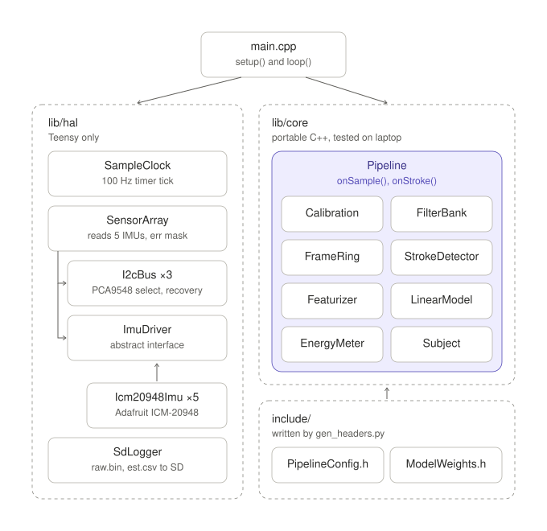
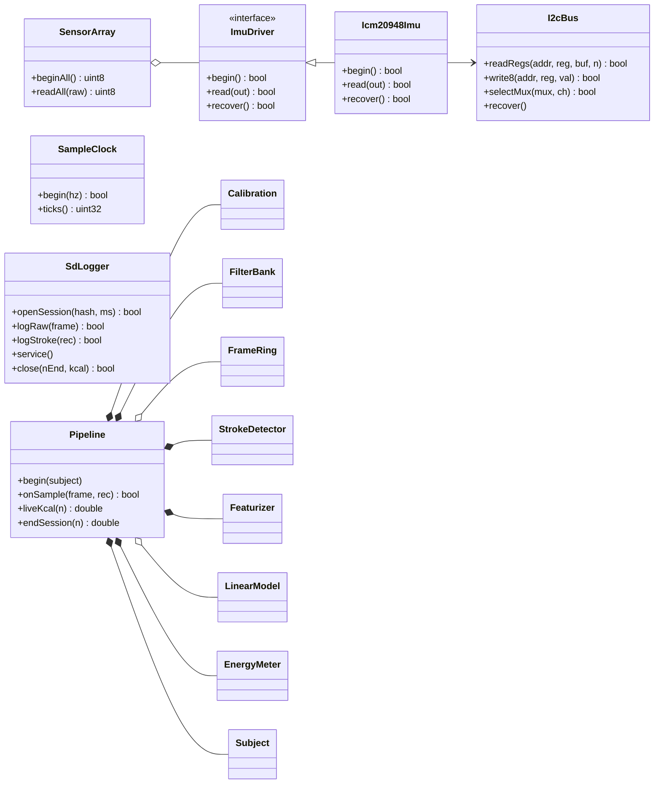
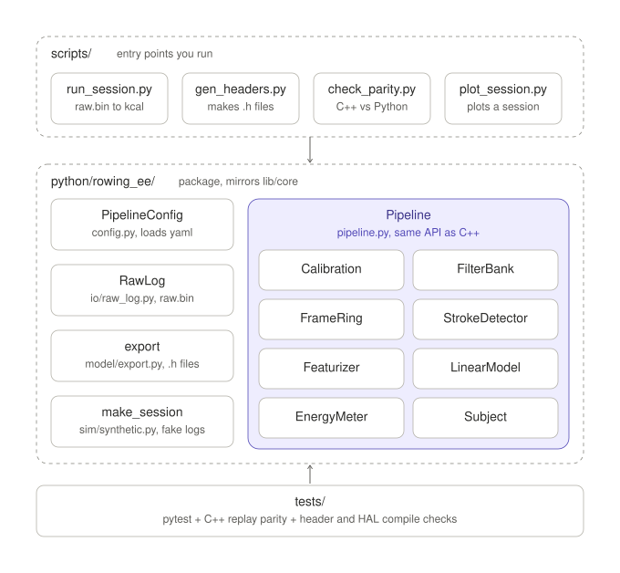

# 5. Architecture: classes, files, functions

Everything lives in this folder of the repo. `firmware/` is what gets flashed to the Teensy 4.1; `python/` and `scripts/` run on a laptop against the SD logs. The C++ `lib/core` and the Python package are deliberate mirrors (same class names, same math), and `scripts/check_parity.py` proves they agree. On synthetic logs with injected I2C failures and missed ticks, they agree to about $10^{-13}$ relative.

## Firmware (Teensy 4.1)



A box drawn inside another box is owned by it. Dashed boxes are folders. `Icm20948Imu` implementing `ImuDriver` is the only inheritance. Nothing in `lib/core` includes `Arduino.h`, which is why the same files compile on a laptop.



## Python package and scripts



## File map

```
rowing-ee/
├── README.md
├── config/pipeline.yaml              # single source of truth (sampling, IMU wiring, filter, detector, bins, energy)
├── firmware/                         # PlatformIO project: what gets flashed
│   ├── platformio.ini
│   ├── src/main.cpp                  # setup(), loop(): wires hardware to lib/core
│   ├── include/                      # GENERATED by scripts/gen_headers.py, do not hand-edit
│   │   ├── PipelineConfig.h
│   │   └── ModelWeights.h
│   ├── lib/hal/                      # Teensy only: Wire, IntervalTimer, SdFat
│   │   ├── SampleClock.{h,cpp}  I2cBus.{h,cpp}  ImuDriver.h
│   │   ├── Icm20948Imu.{h,cpp}  SensorArray.{h,cpp}  SdLogger.{h,cpp}
│   ├── lib/core/                     # portable C++17, no Arduino.h
│   │   ├── Types.h  Subject.{h,cpp}  Calibration.{h,cpp}  FilterBank.{h,cpp}  FrameRing.{h,cpp}
│   │   ├── StrokeDetector.{h,cpp}  Featurizer.{h,cpp}  LinearModel.{h,cpp}
│   │   └── EnergyMeter.{h,cpp}  Pipeline.{h,cpp}
│   └── test/native/                  # laptop builds: replay tool, HAL syntax check, stub headers
├── python/
│   ├── pyproject.toml
│   └── rowing_ee/
│       ├── config.py  subject.py  energy.py  pipeline.py
│       ├── io/raw_log.py
│       ├── dsp/calibration.py  dsp/filters.py  dsp/ring.py  dsp/detector.py  dsp/features.py
│       ├── model/linear_model.py  model/export.py
│       └── sim/synthetic.py
├── scripts/  run_session.py  plot_session.py  gen_headers.py  check_parity.py  make_synthetic_log.py
├── tests/    test_dsp.py  test_session.py
├── docs/     01..06 *.md, diagrams/*.svg
└── data/     (gitignored) raw/*.bin, est/*.csv, subjects.yaml
```

## Critical functions: firmware

| File | Function | What it does |
|---|---|---|
| `src/main.cpp` | `setup()` | Starts the three I2C buses and five IMUs and reports any not found. Reads `subject.cfg`, opens `raw_###.bin` / `est_###.csv`, calls `pipeline.begin()`, starts the 100 Hz clock. |
| | `loop()` | Processes every due tick: a missed tick becomes an `ERR_GAP` frame. Then `readAll` → `logRaw` → `onSample` → `logStroke`. Services the SD card, prints status once a second, and `q` closes the session. |
| `hal/SampleClock` | `begin(hz)`, `ticks()` | The `IntervalTimer` interrupt only increments a counter; no I2C runs inside it. |
| `hal/I2cBus` | `readRegs()`, `write8()` | Register burst read/write; counts failures. |
| | `selectMux(addr, ch)` | Opens a PCA9548 channel (cached). With two muxes on one bus, it closes the other mux first. |
| | `recover()` | Clocks SCL up to 9 times and sends a STOP to free a stuck SDA, then restarts the port. |
| `hal/ImuDriver` | `begin()`, `read(out[6])`, `recover()` | Interface every chip driver implements. |
| `hal/Icm20948Imu` | `begin()` | Checks WHO_AM_I = 0xEA, resets and wakes the chip, and sets ODR 225 Hz, DLPF ~24 Hz, ±8 g and ±2000 dps from `PipelineConfig.h`. |
| | `read(out[6])` | One 12-byte burst from 0x2D, big-endian → counts. |
| `hal/SensorArray` | `readAll(raw)` | Reads the IMUs in config order. A failed read is retried once; if it still fails, the last good value is held and the IMU's error bit is set. Re-initialises an IMU after 100 consecutive failures. |
| `hal/SdLogger` | `openSession()` | Picks the next free `raw_###` index, preallocates the files and writes the 32-byte header. |
| | `logRaw()`, `logStroke()` | Serialize records into RAM ring buffers. |
| | `service()` | Moves 512-byte blocks to the card only when it isn't busy. |
| | `close(nEnd, kcal)` | Writes the `# end` line, then syncs, truncates and closes both files. |
| `core/Calibration` | `addStill(raw)` | Accumulates the still window. Sets the gyro bias when every axis has std ≤ 0.05 rad/s; otherwise retries. |
| | `apply(raw, out)` | Counts → SI units, subtracts the gyro bias, rotates by `PC_MOUNT`. |
| `core/FilterBank` | `reset(x0)`, `step(x, y)` | Butterworth DF-II-T on 30 channels with a steady-state start. |
| `core/FrameRing` | `push()`, `contains()`, `at()`, `errAt()` | 10 s float32 buffer, indexed by sample number. |
| `core/StrokeDetector` | `step(s, n, n0, n1)` | Adaptive-threshold drive-peak picker with hysteresis. Returns `First` or `Stroke`. |
| `core/Featurizer` | `extract(ring, n0, n1, subj, x)` | Builds `x[904] = [1, m, h, T, bin means...]`. |
| `core/LinearModel` | `predict(x, pRest, pRaw, flag)` | Computes `w·x`, caps it at 2500 W (flag set), floors it at the resting power. |
| `core/EnergyMeter` | `begin`, `startBout`, `addStroke`, `tick`, `liveKcal`, `end` | Exact time tiling: strokes billed at P, pauses at P_rest. |
| `core/Subject` | `restWatts(k)`, `parseSubjectCfg()` | Mifflin–St Jeor in watts; parses the SD card's `subject.cfg`. |
| `core/Pipeline` | `onSample(frame, rec)` | Calibrate → filter → ring → detector → stroke. Returns true when a stroke was scored. |
| | `onStroke(n0, n1, rec)` | Validity checks (buffered, ≤ 5 % held samples), then `extract` → `predict` → `addStroke`. |

## Critical functions: Python

| File | Function | What it does |
|---|---|---|
| `config.py` | `PipelineConfig.load()` | Validates the YAML and derives every constant: scales, sample counts, D, detect channel. |
| | `feature_hash()` | 32-bit hash of every setting that changes features. Stamped into both headers and every log. |
| `io/raw_log.py` | `RawLog.read()` | Parses `raw_###.bin`: drops the preallocated tail and unwraps `micros()`. |
| | `timing_report()` | Interval statistics, gap-filled frames, error counts per IMU. |
| | `write_raw_log()` | Writes the firmware's format (used for synthetic logs). |
| `dsp/*.py` | `Calibration`, `FilterBank`, `FrameRing`, `StrokeDetector`, `Featurizer` | Line-for-line mirrors of `lib/core`. `FilterBank.run()` uses `scipy.signal.sosfilt`, which is the same recurrence. |
| `model/linear_model.py` | `predict()` | Same cap and floor as the C++. |
| | `fold_normalization()` | Bakes the z-scoring into the weights. |
| | `load()`, `save_csv()` | Weights as CSV (intercept first) or NPZ. |
| `model/export.py` | `write_config_header()`, `write_weights_header()` | Generate `firmware/include/*.h` with exactly round-tripping doubles. |
| `energy.py` | `EnergyMeter` | Same methods as the C++. |
| `pipeline.py` | `Pipeline.on_sample()` | Streaming mirror of `Pipeline::onSample`. |
| | `Pipeline.run_session()` | Fast batch path (vectorized filter, same detector loop) → `SessionResult`. |
| | `SessionResult.to_csv()`, `read_est_csv()` | Same CSV format as the firmware's `est_###.csv`. |
| `sim/synthetic.py` | `make_session()` | Rowing-like logs with bouts, rests, I2C failures and missed ticks. Plumbing test, not physiology. |
| `scripts/run_session.py` | | `raw.bin` + subject → summary JSON, per-stroke CSV, optional plot. |
| `scripts/gen_headers.py` | | `pipeline.yaml` (+ `--weights`) → both headers. |
| `scripts/check_parity.py` | | Builds `firmware/test/native/replay`, replays the same log, compares every stroke. |
| `scripts/make_synthetic_log.py` | | Writes a synthetic `raw.bin` for trying the pipeline without hardware. |

## How the pieces connect

1. Edit `config/pipeline.yaml` → `python scripts/gen_headers.py` → `cd firmware && pio run -e teensy41 -t upload`.
2. Row. Copy `raw_###.bin` and `est_###.csv` from the SD card into `data/raw/` → `python scripts/run_session.py data/raw/raw_000.bin --subject S01 --plot`.
3. `python scripts/check_parity.py data/raw/raw_000.bin --est data/raw/est_000.csv --tol 1e-4` confirms the board and the laptop agree. Use a looser tolerance because the board writes 6 decimals.
4. When a model is trained: `python scripts/gen_headers.py --weights models/weights.csv`, then re-flash.
